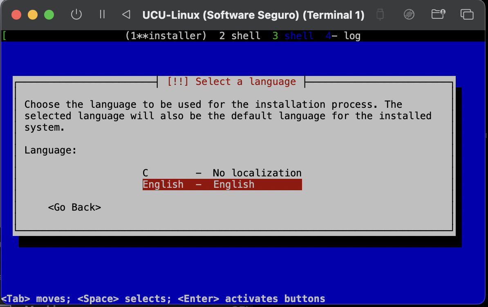
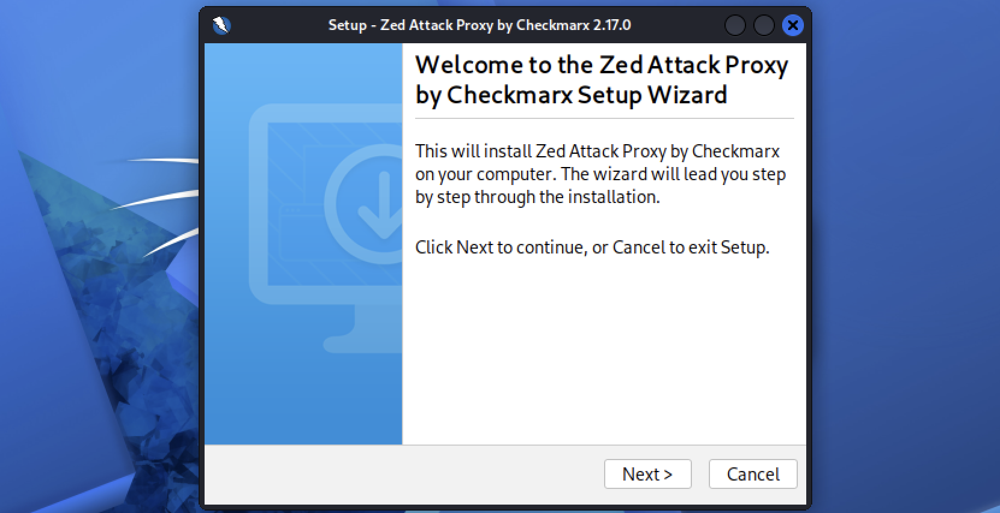
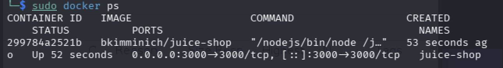
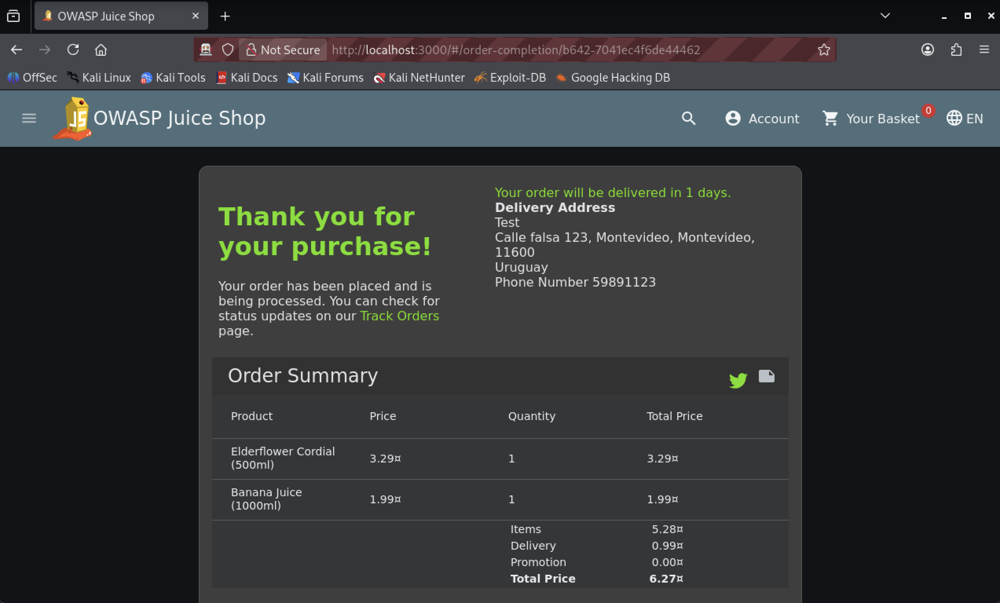

# Setup (Write Up)

Armado de un ambiente de pruebas de aplicaciones en el siguiente entorno: maquina host **MacBook** Sequoia (15.2), utilizando **UTM** ([ref.](https://getutm.app)) como emulador virtual de escritorio con **Kali Linux** ([6.19.14+kali-arm64](https://cdimage.kali.org/kali-2026.2/kali-linux-2026.2-installer-arm64.iso)) como guest, asi correr **OWASP ZAP** ([ref.](https://www.zaproxy.org)) y testear, <i>dado este caso practico</i> la aplicacion web **Juice Shop** ([ref.](juice)).

> References: [Consigna Práctica 1](./2026%201.4-DSS-Consigna%20práctica%201-2.pdf) e [Intorudccion / Ejemplo](./Introducción%20a%20la%20seguridad%20de%20aplicaciones%20-%20Jornada%204.pptx.pdf)

## 1. Instalacion de Kali Linux



Primero se instalo el emulador virtual **UTM** y se descargo la imagen ARM de **Kali Linux** version [6.19.14+kali-arm64](https://cdimage.kali.org/kali-2026.2/kali-linux-2026.2-installer-arm64.iso). Luego se [instalo y configuro (<i>"console only mode"</i>)](https://www.kali.org/docs/virtualization/install-utm-guest-vm/) el guest con 8 GB de RAM, 50 GB de almacenamiento y 4 CPU Cores.

> Downloads: Emulador Virtual UTM ([Instalacion](https://mac.getutm.app)), Kali Linux ([Images](https://www.kali.org/get-kali/#kali-installer-images))

## 2. Instalacion de Aplicaciones



### 2.1 OWASP ZAP

Se descargo e instalo el instalador [Linux ZAP 2.17.0](https://github.com/zaproxy/zaproxy/releases/download/v2.17.0/ZAP_2_17_0_unix.sh), comandos:

```zsh
cd ~/Downloads
chmod +x ./ZAP_2_17_0_unix.sh
sudo ./ZAP_2_17_0_unix.sh
```

> Alt: Burp Suite Community ([ref.](https://portswigger.net/burp/communitydownload))

### 2.2 Visual Studio

Se descargo e instalo el instalador de [Visual Studio](https://code.visualstudio.com/download?_exp_download=fb315fc982) para debian [.deb (Arm64)](https://vscode.download.prss.microsoft.com/dbazure/download/stable/a5b500951314efd502d07465bd138dfbd714a960/code_1.133.0-1786487973_arm64.deb)

```zsh
cd ~/Downloads
sudo apt install ./code_1.133.0-1786487973_arm64.deb
```

### 2.4 Docker



Se instalo el motor de contenedores Docker, [ref.](https://docs.docker.com/engine/install/debian/#install-using-the-repository), comandos abreviados:

```zsh
sudo apt update
sudo apt install -y docker.io
sudo systemctl enable docker --now
```

### 2.5 Vagrant

No se instalo Vagrant ya que no tiene una version linux arm64 ([ref. comandos de instalacion](https://developer.hashicorp.com/vagrant/install#linux)).

## 3. Aplicacion de Testeo



Se utilizo Docker para descargar la imagen oficial de [Juice Shop](https://owasp.org/www-project-juice-shop/) y exponer la aplicacion en el puerto `3000`.

> Note: [github repo](https://github.com/juice-shop/juice-shop
), link [http://localhost:3000](http://localhost:3000)

### Visualizacion del trafico

Se verifico el correcto funcionamiento del proxy interceptando el trafico con la aplicacion de prueba.

1. En la pantalla **"Manual Explore"**, se ingreso `localhost:3000`.
> **HUD** como falso.

2. Se procedio via **'Launch Browser'** (Utilizando Firefox).

3. Se visualizo el trafico, ejemplo:

```json
{"fullName":"Bruno","cardNum":1234432112344321,"expMonth":"11","expYear":"2080"}
```

> POST http://localhost:3000/api/Cards/
